# Freshwater Macroinvertebrate Classification

Macroinvertebrates, such as insects, crustaceans, and molluscs, are important indicators of water quality and are often used in biomonitoring. Traditionally, identifying these organisms depends on taxonomic experts, which can be slow and prone to mistakes. Using machine learning could speed up the process and produce more consistent results, provided the models are chosen carefully.

Our dataset contains 5,514 observations with 65 measurements for each specimen, covering both shape and intensity features. For the initial exploratory work, we focused on 16 features: area (`Area`), perimeter (`Perim`), width (`Width`), height (`Height`), major and minor axes (`Major`, `Minor`), angle (`Angle`), circularity (`Circ`), Feret diameter (`Feret`), and grey-level intensity measures including mean (`Mean.gray.`), standard deviation (`StdDev.gray.`), mode (`Mode.gray.`), integrated density (`IntDen.gray.`), median (`Median.gray.`), skewness (`Skew.gray.`), and kurtosis (`Kurt.gray.`). The dataset covers 35 different taxa. Some species, like *Taenneb*, are well represented with 500 samples (followed by *Isoperla* with 450, *Aselaqua* with 278, and *Protintr* with 268), while others, such as *Ceratopogonidae*, have only 48. This imbalance makes classification more difficult, as models may favour the more common classes.

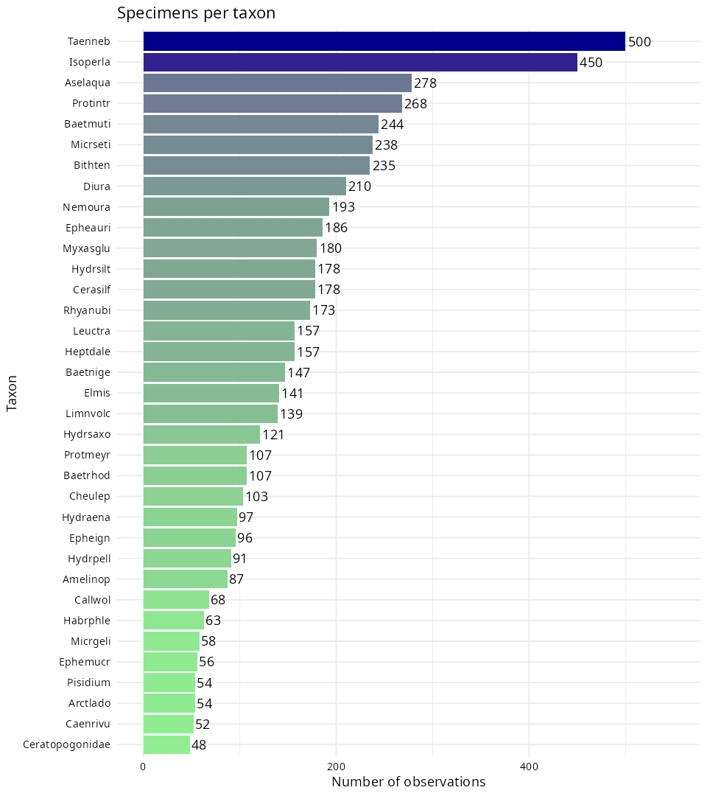

## Running the analysis

With `waterbugs_training.dat.txt` and `waterbugs_testing.dat.txt` placed in `data/`, run the whole analysis from the project root:

```bash
Rscript run.R
```

`run.R` loads `R/setup.R` (which sets the seed `734985` and loads `ggplot2`, `dplyr`, `corrplot`, `randomForest`, `caret`, `MASS`, `klaR`, and `glmnet`) and runs the scripts in `R/` in order: `explore.R`, `maps.R`, `models.R`, `bounds.R`, and `logistic.R`. All generated plots are written to `figures/` and summary tables to `results/`.

## Dataset Exploration

### Feature Distributions and Correlations

Each feature was examined using Q–Q plots. The grey-level intensity features are mostly symmetric and continuous, with only minor deviations from normality, while size-related measurements such as area and perimeter are right-skewed because a few taxa are much larger than the rest.

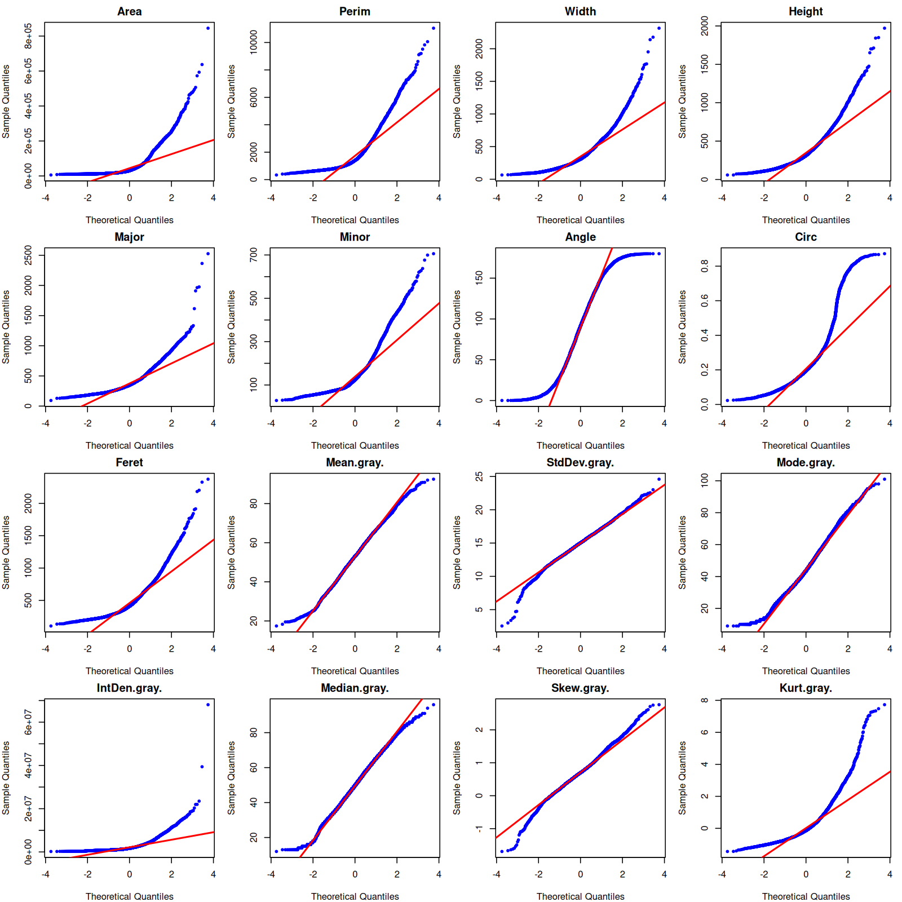

To check the joint distribution across all 16 features, squared Mahalanobis distances were calculated as

$$
D^2 = (x - \mu)^\top \Sigma^{-1} (x - \mu),
$$

where $x$ is the feature vector, $\mu$ is the mean vector, and $\Sigma$ is the covariance matrix. The Mahalanobis distance Q–Q plot shows that the distances roughly follow a chi-square distribution across most of the data, indicating an approximate elliptical distribution. This supports the use of parametric classification methods such as discriminant analysis.

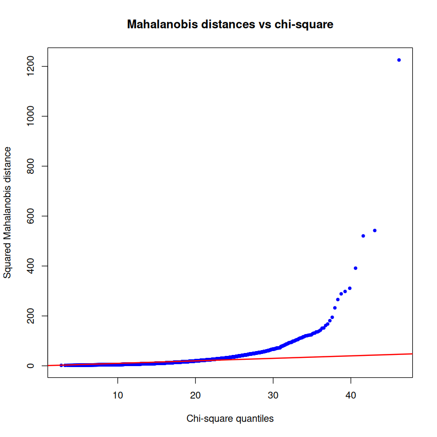

The features also show clear correlation patterns. Shape-related measurements, such as `Area`, `Perim`, `Major`, and `Feret`, are closely related, while the intensity statistics vary together within the grey and colour channels. Understanding these relationships is important when training models to classify macroinvertebrates accurately, as strongly correlated features carry overlapping information.

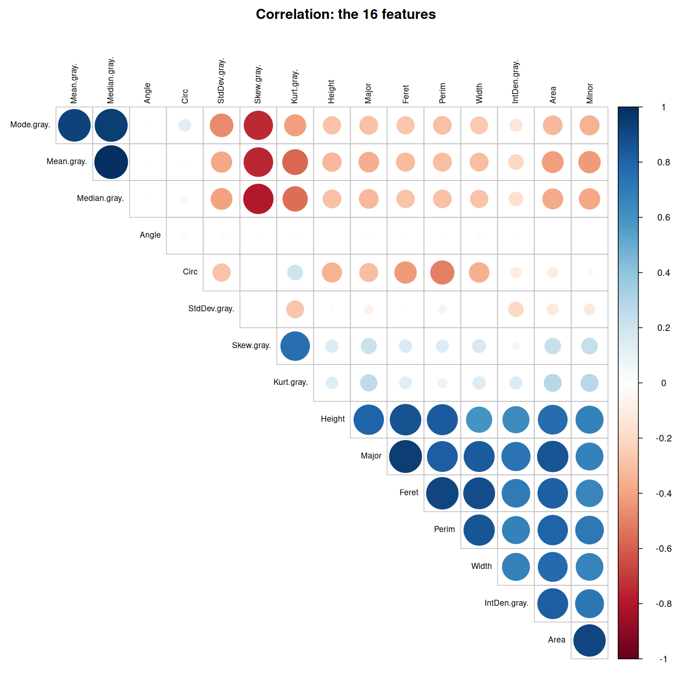

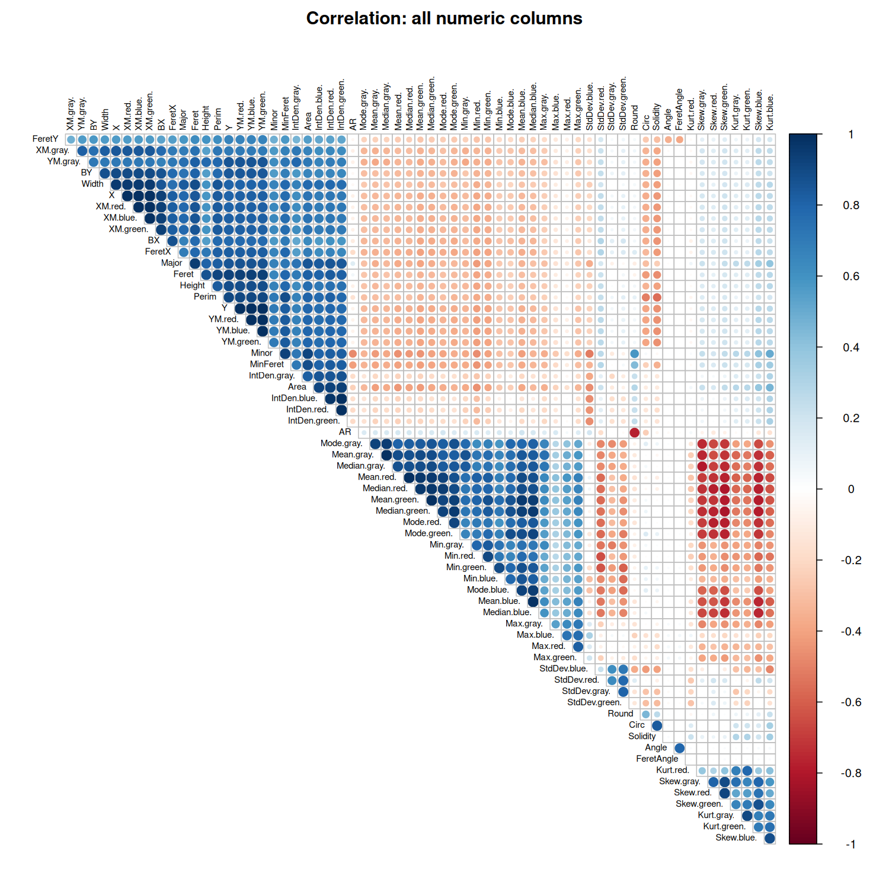

### Principal Component Analysis

Principal Component Analysis (PCA) was applied to the 16 standardised features to understand the structure of the macroinvertebrate dataset and see if the features naturally separate the taxa. The first principal component (PC1) explains 45.82% of the variance, PC2 explains 21.17%, and PC3 explains 11.21%. Together, the first 5 principal components capture 90.05% of the total variance, and the first 7 components capture 94.68%. The scree plot confirms that the first few components capture most of the variation, reflecting the correlations among the morphological measurements.

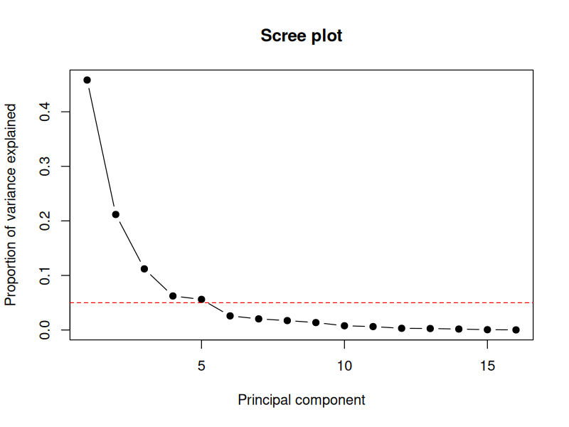

As shown in the PC1–PC2 scatter plot, the first two principal components show clear clustering for the most common taxa, while rare taxa are harder to see because there are fewer samples and they contribute little to the overall variation.

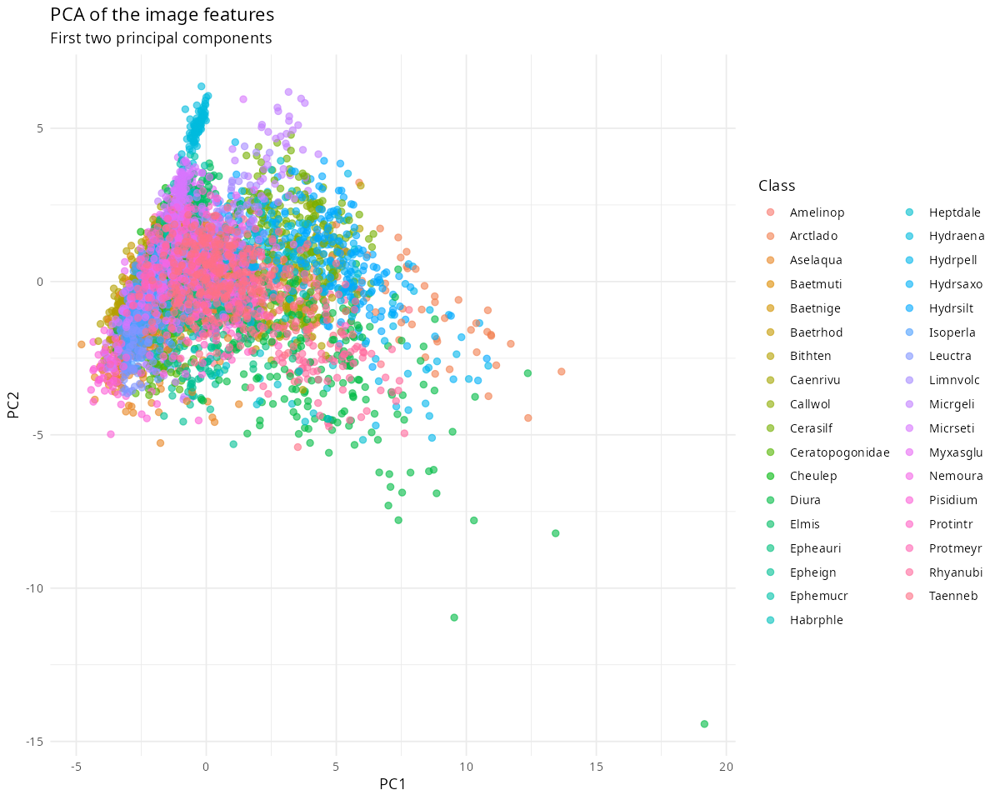

Mathematically, the overall mean

$$
\bar{x} = \frac{1}{n} \sum_{c=1}^{C} n_c \mu_c
$$

and the total covariance

$$
\Sigma = \frac{1}{n - 1} \sum_{i=1}^{n} (x_i - \bar{x})(x_i - \bar{x})^\top
$$

are weighted by the number of samples in each class. This means the principal components mainly reflect the variation of the abundant taxa. PCA helps summarise the data, but it does not improve classification when passed into other models because rare taxa contribute little to the leading components.

### Outliers and Uncertainty

Outliers and ambiguous specimens were examined using class maps (`R/maps.R`), which plot the probability of alternative class (PAC, computed from out-of-bag Random Forest probabilities) against farness (the rank-normalised Mahalanobis distance of each specimen from its own class centre, with points above 0.95 marked as outliers). These analyses showed that some rare taxa have high variability, highlighting the need for models that can account for class-specific covariance and uncertainty.

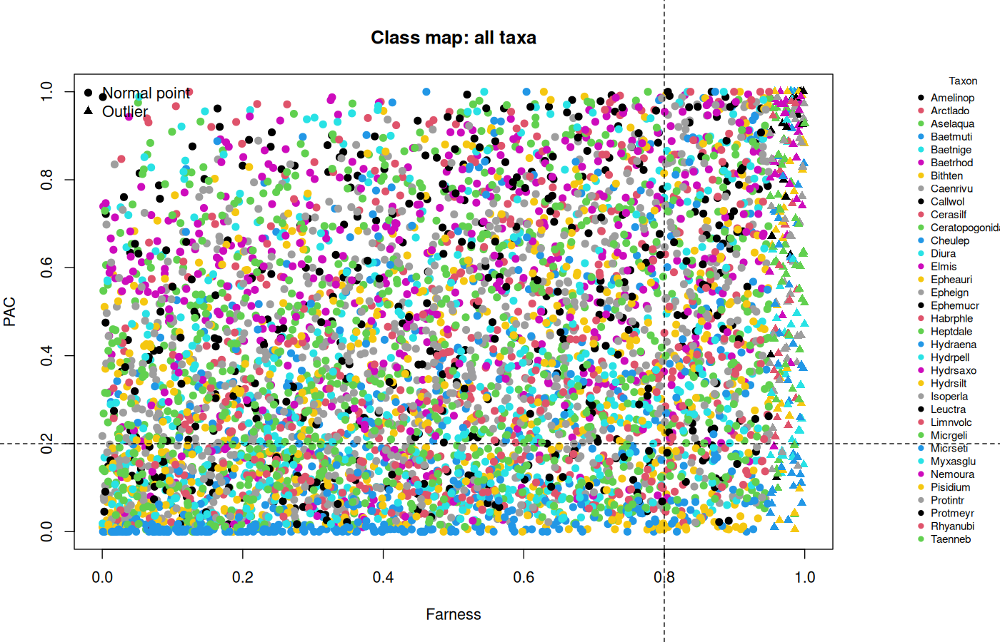

## Multi-Class Classification and Model Performance

Before fitting the classifiers in `R/models.R`, the dataset was split into an 80% training set and a 20% hold-out test set. Using only the 80% training split across all 65 columns, near-zero-variance predictors, variables with pairwise correlations above 0.75, and linear combinations were removed. This filtering kept 15 features (`results/keptFeatures.txt`): `Angle`, `Circ`, `FeretY`, `AR`, `StdDev.gray.`, `Min.gray.`, `Max.gray.`, `XM.gray.`, `StdDev.blue.`, `Min.blue.`, `Max.blue.`, `Max.red.`, `IntDen.red.`, `Skew.red.`, and `Kurt.red.`.

Seven models were trained on the 80% training data using 10-fold cross-validation repeated 5 times: Quadratic Discriminant Analysis (`QDA`), Random Forest (`RF`), Random Forest with PCA (`RF_PCA`), k-Nearest Neighbours (`kNN`), k-Nearest Neighbours with PCA (`kNN_PCA`), Linear Discriminant Analysis (`LDA`), and a Decision Tree (`Tree`). The table below summarises their cross-validated performance (`results/cvTable.csv`).

| Model | Mean Accuracy | Mean Kappa | Misclassification Error |
| :--- | :---: | :---: | :---: |
| QDA | 0.7144 | 0.7021 | 0.2856 |
| RF | 0.7015 | 0.6879 | 0.2985 |
| RF_PCA | 0.6088 | 0.5900 | 0.3912 |
| kNN | 0.5894 | 0.5706 | 0.4106 |
| kNN_PCA | 0.5711 | 0.5516 | 0.4289 |
| LDA | 0.5512 | 0.5307 | 0.4488 |
| Tree | 0.3979 | 0.3674 | 0.6021 |

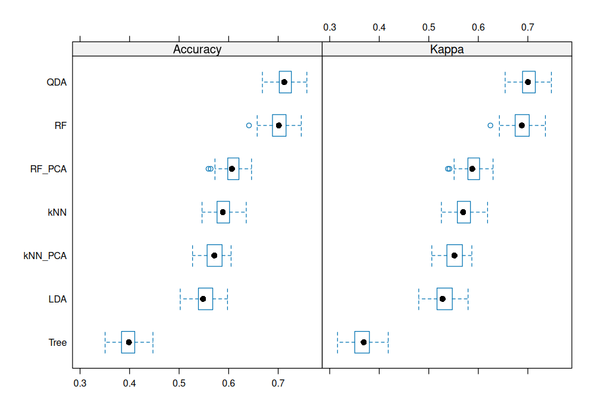

QDA achieved the lowest misclassification error (`0.2856`, accuracy `0.7144`, kappa `0.7021`), followed closely by Random Forest (`0.7015` accuracy). Evaluating the trained QDA model on the untouched 20% hold-out test set (`results/holdout.csv`) gave an overall accuracy of `0.7325` (95% CI: `0.7052, 0.7586`), a Kappa of `0.7209`, macro-precision of `0.7384`, macro-recall of `0.7240`, macro-F1 of `0.7311`, and balanced accuracy of `0.8580`. On the hold-out set, distinctive taxa such as *Micrgeli*, *Myxasglu*, *Pisidium*, and *Callwol* reached `1.0000` sensitivity (and *Bithten* and *Micrseti* reached `0.9787`), while the hardest taxa to classify were *Heptdale* (`0.2258` sensitivity), *Habrphle* (`0.3333`), *Hydrpell* (`0.3889`), *Hydrsaxo* (`0.4167`), and *Protmeyr* (`0.4286`).

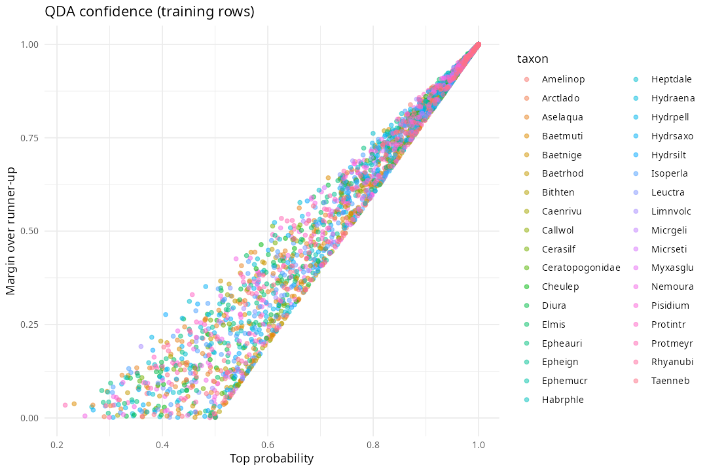

### QDA Visualisation

QDA is particularly well-suited for this dataset because it allows each class to have its own covariance matrix. Taxa differ not only in their mean feature values but also in how their features vary. The discriminant function for QDA is:

$$
g_i(x) = -\frac{1}{2}(x - \mu_i)^\top \Sigma_i^{-1}(x - \mu_i) - \frac{1}{2}\ln|\Sigma_i| + \ln P(\omega_i),
$$

where $\mu_i$ and $\Sigma_i$ are the mean vector and covariance matrix for taxon $i$, and $P(\omega_i)$ is its prior probability. Unlike LDA, which assumes equal covariance across all taxa, QDA can model the unique variance structure of each class, which is critical for accurate classification.

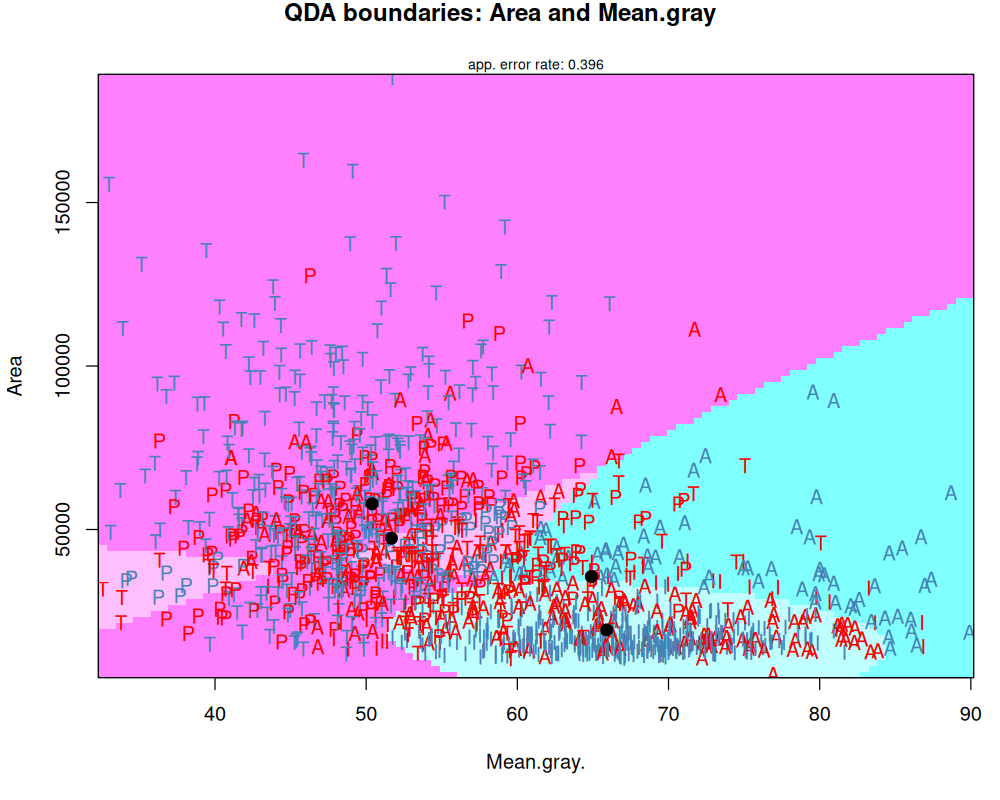

The QDA decision boundaries for the four most common species (*Taenneb*, *Isoperla*, *Aselaqua*, and *Protintr*) using only the features `Area` and `Mean.gray.` are shown above (`R/bounds.R`). Correctly classified points are coloured steel blue and misclassified points are red. Using just these two features, the model produces curved boundaries that follow the structure of the data with an overall error rate of `0.396` (`results/boundaryError.txt`). This error rate is specific to this four-species, two-feature plot and should not be interpreted as the overall error rate of the full 15-feature QDA model.

### Discussion: Class Maps and the Performance of QDA

This dataset presents two main challenges: class imbalance and differences in feature variability between taxa. Some taxa are well represented in the dataset, while others have only a small number of samples. This imbalance makes classification more difficult because models tend to learn patterns from common taxa more easily than from rare ones. In addition, the spread of the features differs across taxa: some taxa form compact clusters in feature space, while others show much wider variation.

The class maps help illustrate these challenges. For the eight most common taxa, points form tight clusters with few mistakes, indicating high classification confidence. In contrast, the eight rarest taxa appear more scattered and contain more misclassified points, reflecting the difficulty of learning reliable patterns when only a small number of samples are available.

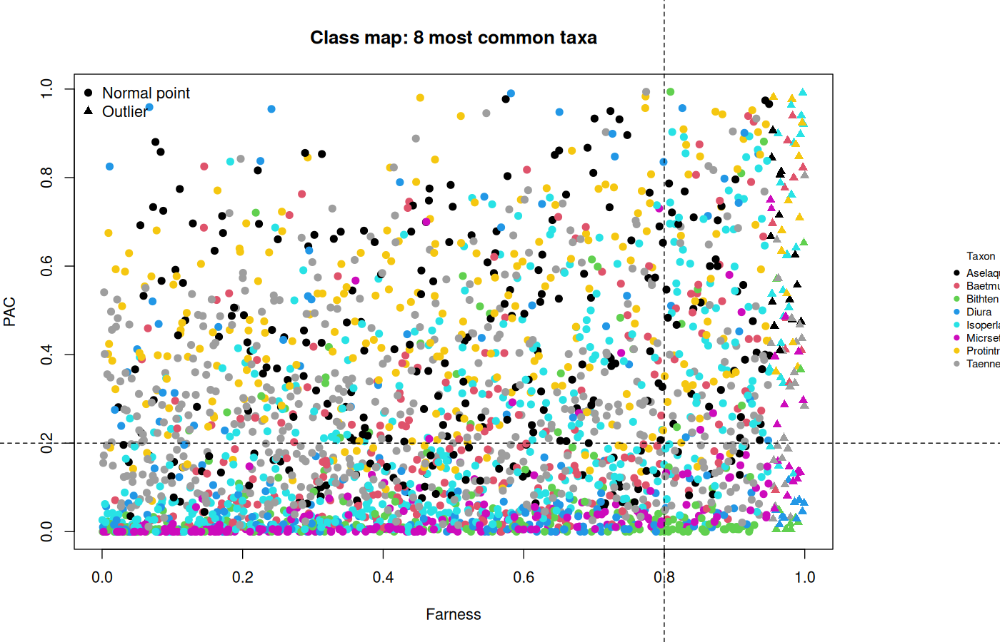

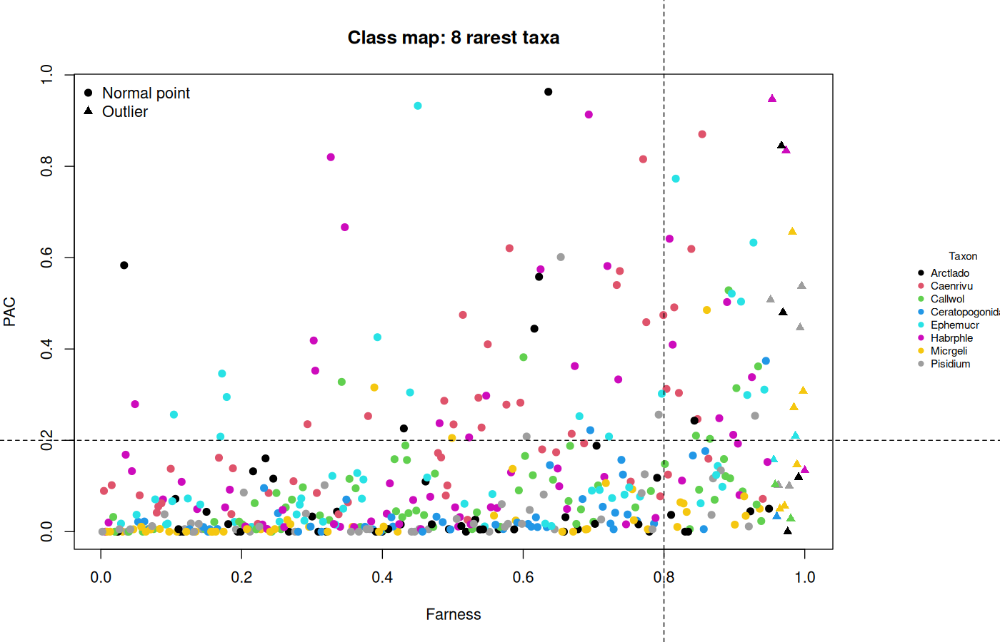

Quadratic Discriminant Analysis performs best because it allows each class to have its own covariance matrix. This flexibility enables the model to capture differences not only in the mean feature values of taxa but also in how their features vary in space. Other models impose stronger assumptions or are more sensitive to the dataset structure: LDA assumes equal covariance across taxa, which produces boundaries that are too simple (`0.5512` accuracy); kNN (`0.5894`) is strongly affected by class imbalance, making rare taxa more likely to be misclassified; and Random Forests (`0.7015`) can model non-linear relationships but still struggle slightly more than QDA when classes overlap strongly and rare taxa contribute little information to the training process.

## Regularised Logistic Regression: *Aselaqua* vs. *Isoperla*

In the second part of the study (`R/logistic.R`), we classify two well-represented species of waterbugs: *Aselaqua* (278 specimens) and *Isoperla* (450 specimens). Logistic regression is a natural choice because it gives a probability for each class. When predictors are many (all 65 measurements) or strongly correlated, standard logistic regression can overfit or give unstable coefficients. To handle this, we compare standard stepwise logistic regression against four regularisation methods using `glmnet`: Ridge, Lasso, Elastic Net, and Relaxed Lasso.

### Logistic Regression Model

For logistic regression, the probability that observation $i$ belongs to a class is

$$
\pi_i = P(Y_i = 1 \mid x_i),
$$

where $x_i = (x_{i1}, x_{i2}, \dots, x_{ip})$ is the vector of predictors. The logit function links this probability to a linear combination of predictors:

$$
\log \frac{\pi_i}{1 - \pi_i} = \beta_0 + x_i^\top \beta,
$$

where $\beta_0$ is the intercept and $\beta$ is the vector of coefficients. The coefficients are estimated using maximum likelihood, with log-likelihood function

$$
\ell(\beta_0, \beta) = \sum_{i=1}^{n} \left[ y_i(\beta_0 + x_i^\top \beta) - \log\left(1 + e^{\beta_0 + x_i^\top \beta}\right) \right]
$$

and maximum likelihood estimator

$$
\hat{\beta} = \arg\max_{\beta} \ell(\beta_0, \beta).
$$

The variance of $\hat{\beta}$ can be approximated as

$$
\text{Var}(\hat{\beta}) \approx (X^\top W X)^{-1},
$$

where $X$ is the model matrix and $W$ is a diagonal matrix with $w_{ii} = \pi_i(1 - \pi_i)$. Highly correlated predictors make $X^\top W X$ nearly singular, which increases variance and can lead to unstable predictions. In addition, when the two species are nearly separable across 65 correlated predictors, standard unpenalised logistic regression produces extreme fitted probabilities (numerically 0 or 1), causing coefficient estimates to blow up and hurting out-of-sample performance.

### Regularised Logistic Regression

Regularised logistic regression adds a penalty to reduce variance:

$$
\min_{\beta_0, \beta} \left[ -\frac{1}{n} \sum_{i=1}^{n} \ell(y_i, \beta_0 + x_i^\top \beta) + \lambda \left( \frac{1 - \alpha}{2} \|\beta\|_2^2 + \alpha \|\beta\|_1 \right) \right],
$$

where $\lambda$ controls the strength of the penalty and $\alpha$ determines the type. Ridge ($\alpha = 0$) shrinks all coefficients slightly. Lasso ($\alpha = 1$) can shrink coefficients to zero and select important predictors. Elastic Net ($0 < \alpha < 1$, here $\alpha = 0.5$) mixes $L_1$ and $L_2$ penalties. Relaxed Lasso reduces bias by refitting an unpenalised logistic model on the predictors selected by Lasso:

$$
\beta_{\text{relax}} = \gamma \beta_{\text{lasso}} + (1 - \gamma)\beta_{\text{LS}}.
$$

### Comparison

Each observation is classified using the threshold rule

$$
\hat{y}_i = \begin{cases} 1 & \pi_i > 0.5 \\ 0 & \pi_i \le 0.5 \end{cases},
$$

and probability error is measured by Mean Squared Error, $\text{MSE} = \frac{1}{n}\sum_{i=1}^{n}(y_i - \hat{\pi}_i)^2$. All five models were evaluated out-of-sample across the same 10 cross-validation folds (`results/logisticTable.csv`), with variable selection (`step` and `cv.glmnet`) repeated inside each fold:

| Model | Accuracy | MSE |
| :--- | :---: | :---: |
| `lasso` | 0.9753 | 0.0189 |
| `elastic` | 0.9725 | 0.0208 |
| `ridge` | 0.9657 | 0.0385 |
| `relaxed` | 0.9643 | 0.0291 |
| `logistic` | 0.9602 | 0.0397 |

When evaluated out-of-sample across 10 folds, `lasso` (`0.9753` accuracy, `0.0189` MSE) and `elastic` (`0.9725` accuracy, `0.0208` MSE) perform best. Because many of the 65 shape and colour-channel features are strongly correlated and the two classes are nearly separable on the training folds, unpenalised stepwise `logistic` (`0.9602` accuracy, `0.0397` MSE) and the unpenalised `relaxed` refit (`0.9643` accuracy, `0.0291` MSE) produce extreme 0/1 fitted probabilities and overfit slightly to the training folds. Shrinking and selecting predictors with Lasso or Elastic Net stabilises the probabilities and cuts the out-of-sample MSE in half. On the full two-species dataset, Lasso keeps 36 variables (`results/lassoVariables.csv`), with the largest weights on shape descriptors (`Circ`, `Round`, `Solidity`, `AR`) and colour standard deviations (`StdDev.blue.`, `StdDev.green.`).

## Conclusion

This study examined the classification of freshwater macroinvertebrates using image-derived morphological and intensity features. Across all 35 taxa, Quadratic Discriminant Analysis provides the most reliable performance (`0.7144` cross-validated accuracy, `0.7325` hold-out accuracy). Unlike models that assume a common covariance structure, QDA allows each taxon to have its own covariance matrix, capturing differences not only in the mean values of features but also in how those features vary within each taxon. For the two-species problem (*Aselaqua* vs. *Isoperla*) across all 65 correlated measurements, $L_1$-regularised logistic regression (Lasso and Elastic Net) prevents the extreme 0/1 probability overfitting of unpenalised logistic regression and achieves the highest out-of-sample accuracy (`0.9753`) and lowest MSE (`0.0189`).

